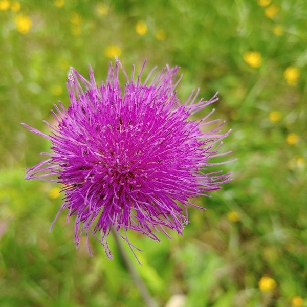
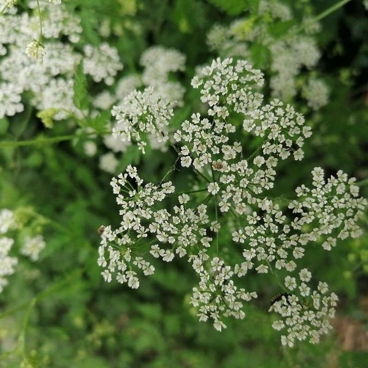
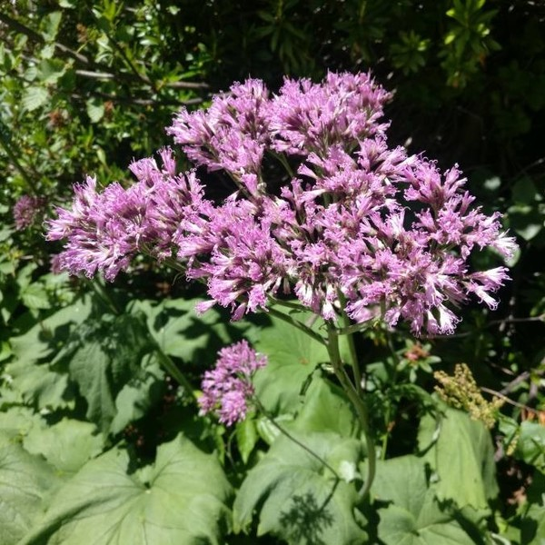

# Pl@ntNet-300K

<p align="middle">
  
  
  
  
</p>

This repository contains training and inference code for **Pl@ntNet-300K-v2**.
The current models fine-tune recent [DINOv3](https://arxiv.org/abs/2508.10104)
ConvNeXt and Vision Transformer backbones, initialized from the LVD-1689M
pretrained weights. The original Pl@ntNet-300K-v1 benchmark code is preserved
in [`legacy_v1/`](legacy_v1/).

## Dataset

Pl@ntNet-300K-v2 contains **306,087 images from 1,000 plant species**. It retains
the long-tailed class distribution and high visual ambiguity of the original
dataset while providing improved images resolution and species names.

- [Download Pl@ntNet-300K-v2](https://zenodo.org/records/10419064)
- [Download Pl@ntNet-300K-v1](https://zenodo.org/records/5645731)
- [Dataset paper](https://openreview.net/forum?id=eLYinD0TtIt)

The v2 dataset root must have the following layout:

```text
plantnet300kv2/
├── images/
│   ├── train/0000/ ... 0999/
│   ├── val/0000/   ... 0999/
│   └── test/0000/  ... 0999/
├── plantnet300K_metadata.csv
└── species_metadata.csv
```

`plantnet300K_metadata.csv` associates each image hash with its numerical
`species_id`, split, author, license, organ, and Pl@ntNet observation. The
`species_metadata.csv` file maps the 1,000 species identifiers to their
scientific names, genus, family, and IUCN status. Please respect the per-image
license and attribution information when reusing images.

## Installation

Python 3.10 or newer is recommended.

```bash
git clone https://github.com/plantnet/PlantNet-300K.git
cd PlantNet-300K
pip install -r requirements.txt
```

The DINOv3 initialization weights are downloaded from Hugging Face the first
time an architecture is constructed. They are license-gated: accept the DINOv3
license on the corresponding model page and authenticate once with
`hf auth login` before training or loading a model.

## Fine-tuning

For example, train DINOv3 ConvNeXt-Tiny on Pl@ntNet-300K-v2 with:

```bash
python main.py \
  --model cnxt \
  --data_dir /path/to/plantnet300kv2 \
  --ckpt_dir ./checkpoints
```

Available architectures are:

| CLI name | Architecture | DINOv3 initialization |
|---|---|---|
| `cnxt` | ConvNeXt-Tiny | `facebook/dinov3-convnext-tiny-pretrain-lvd1689m` |
| `cnxs` | ConvNeXt-Small | `facebook/dinov3-convnext-small-pretrain-lvd1689m` |
| `cnxb` | ConvNeXt-Base | `facebook/dinov3-convnext-base-pretrain-lvd1689m` |
| `vits` | ViT-S/16 | `facebook/dinov3-vits16-pretrain-lvd1689m` |
| `vitsplus` | ViT-S+/16 | `facebook/dinov3-vits16plus-pretrain-lvd1689m` |
| `vitb` | ViT-B/16 | `facebook/dinov3-vitb16-pretrain-lvd1689m` |

The main options are:

| Argument | Default | Description |
|---|---:|---|
| `--data_dir` | required | Pl@ntNet-300K-v2 root |
| `--model` | required | One of `cnxt`, `cnxs`, `cnxb`, `vits`, `vitsplus`, or `vitb` |
| `--ckpt_dir` | `./checkpoints` | Checkpoint output directory |
| `--device` | `cuda` | Training device |
| `--batch_size` | `256` | Batch size |
| `--num_workers` | `32` | Data-loading workers |
| `--epochs` | `30` | Fine-tuning epochs |

Additional optimization, augmentation, evaluation, and logging arguments are
documented in [`args.py`](args.py).

Add `--wandb` to log the run to Weights & Biases. Use
`--wandb_projname`, `--wandb_entity`, and `--wandb_tmpdir` to configure it.

## Fine-tuned models

All models below were trained with the provided code on the 1,000-class v2
dataset. Accuracy is top-1.

The complete release is available in the
[Pl@ntNet-300K-v2 Hugging Face collection](https://huggingface.co/collections/PlantNet/plntnet-300k-v2-models).
The links in the table provide alternate direct checkpoint downloads.

| Model | Best validation accuracy | Test accuracy | Weights |
|---|---:|---:|---|
| CNX-T | 0.8248 | 0.8216 | [Download](https://drive.google.com/file/d/1dr3k9_LqME0Gn1P126aBCVo6LFYN8ck0/view?usp=sharing) |
| CNX-S | 0.8303 | 0.8296 | [Download](https://drive.google.com/file/d/1PfqwoK3siBHDxojWaUnD3_VAb32s4lQc/view?usp=sharing) |
| CNX-B | 0.8358 | 0.8331 | [Download](https://drive.google.com/file/d/1wWmKvqqr34tR8HdbkrGJmwbjfXXATkPM/view?usp=sharing) |
| ViT-S | 0.8296 | 0.8297 | [Download](https://drive.google.com/file/d/1lnmhQzbbivsaBy80AQzFVITlDP-KaV5N/view?usp=sharing) |
| ViT-S+ | 0.8328 | 0.8293 | [Download](https://drive.google.com/file/d/1NyCElv_iN-0Ztb3seSm4SiCTN4Oz3js_/view?usp=sharing) |
| ViT-B | **0.8462** | **0.8457** | [Download](https://drive.google.com/file/d/1b2mi-NlKHlIeNsKaWKgrLCEx3Z2KaEV2/view?usp=sharing) |

## Loading a model and extracting embeddings

`load_model` constructs the requested DINOv3 architecture, loads a fine-tuned
checkpoint, moves it to the selected device, and enables evaluation mode. A
forward pass returns both the image embedding and the 1,000 classifier logits.

```python
from pathlib import Path

import pandas as pd
import torch
from PIL import Image

from model import load_model
from transforms import ValTransform

device = "cuda" if torch.cuda.is_available() else "cpu"
data_dir = Path("/path/to/plantnet300kv2")
model = load_model("cnxt", "/path/to/plantnet300kv2_cnxt.pth", device=device)
transform = ValTransform()

image = transform(Image.open("images/1.jpg").convert("RGB"))
images = image.unsqueeze(0).to(device)

with torch.inference_mode():
    embeddings, logits = model(images)

predicted_species_id = logits.argmax(dim=1).item()
species_metadata = pd.read_csv(data_dir / "species_metadata.csv")
species_name = species_metadata.loc[
    species_metadata["species_id"] == predicted_species_id,
    "full_species",
].item()

print(f"Predicted species: {species_name} (ID: {predicted_species_id:04d})")
```

The outputs are also named, so `output.embeddings` and `output.logits` can be
used instead of tuple unpacking. Class indices follow sorted `species_id` order;
for v2 this is `0000` through `0999`. Use `species_metadata.csv` to recover the
corresponding species name.

## Citation

For the Pl@ntNet-300K dataset, please cite:

```bibtex
@inproceedings{plantnet-300k,
  author    = {Garcin, Camille and Joly, Alexis and Bonnet, Pierre and
               Lombardo, Jean-Christophe and Affouard, Antoine and
               Chouet, Mathias and Servajean, Maximilien and
               Lorieul, Titouan and Salmon, Joseph},
  booktitle = {NeurIPS Datasets and Benchmarks 2021},
  title     = {{Pl@ntNet-300K}: a plant image dataset with high label
               ambiguity and a long-tailed distribution},
  year      = {2021}
}
```

For the training configuration, please cite:

```bibtex
@misc{moummad2026,
  title         = {Energy-Efficient Plant Monitoring via Knowledge Distillation},
  author        = {Ilyass Moummad and Reda Bensaid and Kawtar Zaher and
                   Hervé Goëau and Jean-Christophe Lombardo and Joseph Salmon and
                   Pierre Bonnet and Alexis Joly},
  year          = {2026},
  eprint        = {2604.27178},
  archivePrefix = {arXiv},
  primaryClass  = {cs.CV},
  url           = {https://arxiv.org/abs/2604.27178}
}
```
